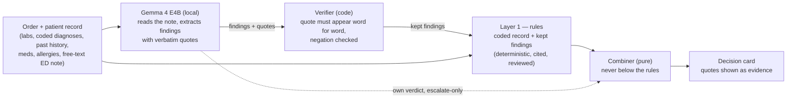

<div align="center">

# OpenMedCheck

**Open-source prescribing check for emergency-department doctors.**
Flags a medication order that conflicts with the patient's labs, diagnoses, past medical history
or free-text note — and stays silent when nothing conflicts. Deterministic rules decide; Gemma 4, running fully
locally, can only escalate.

[](https://github.com/adricasi/OpenMedCheck/actions/workflows/ci-python.yml)
[](https://github.com/adricasi/OpenMedCheck/actions/workflows/security.yml)
[](LICENSE)
[](pyproject.toml)
[](#-disclaimer)

[Quick start](#-quick-start) ·
[How it works](#-how-it-works) ·
[Configuration](#-configuration) ·
[Architecture](#-architecture--deployment) ·
[Contributing](#-contributing)

</div>

## 🚨 Disclaimer

> **Not for clinical use — synthetic patients. Not a medical device.** OpenMedCheck is a concept
> demonstrator built for the DEV Hacktoberfest Open-Source AI Challenge. It works on synthetic
> patients only, gives no medical advice, and must not be used for any real patient.

## Table of contents

- [What it does](#what-it-does)
- [How it works](#-how-it-works)
- [Why open weights — and who would pay](#-why-open-weights--and-who-would-pay)
- [Try it](#-try-it)
- [Quick start](#-quick-start)
- [Using the demo](#using-the-demo)
- [Configuration](#-configuration)
- [Tests and checks](#-tests-and-checks)
- [Evaluation set](#-evaluation-set)
- [Measurements](#-measurements)
- [Architecture & deployment](#-architecture--deployment)
- [Privacy and zero egress](#-privacy-and-zero-egress)
- [Licence and credits](#-licence-and-credits)
- [Contributing](#-contributing)
- [Development workflow](#-development-workflow-spec-driven)

## What it does

**In one example:** the ED note says *"Suspected ACS … On daily aspirin"*, the coded record is
still empty, and the order is dexketoprofen (an NSAID). OpenMedCheck's rules alone give `NO_ISSUE`.
OpenMedCheck reads the note with Gemma 4 on local hardware, flags the order `BLOCKED` with the
doctor's own words as evidence, and suggests paracetamol 1 g every 8 hours, re-checked first.
The prescriber still decides.

**It also looks at the patient's past.** A previous GI bleed or a previous heart attack is a
reason to think twice about an NSAID even when nothing current conflicts. Gemma reads the
record's past medical history (free text, as charts usually keep it) and the ED note, and quotes
the line that matters ("Myocardial infarction in 2020, treated with a coronary stent", "Previous
GI bleed in 2015, none since"); the history rules then fire on the verified quote. "No history of
GI bleeding" or "Mother had a GI bleed" stay silent, and an old event never counts as a current
one ([ADR 0009](docs/adr/0009-patient-history-is-an-input.md)).

Rooms **Bed 5** and **Bed 14** show why this matters. In Bed 5 today's visit is routine: a
wrist sprain after a fall, normal labs, ibuprofen for the pain. The line these checks look for,
"Upper GI bleed from a duodenal ulcer in 2021", sits between the knee arthroscopy and the
cataract surgery in a long past medical history: a line that can be missed under time pressure.
Bed 14 is a knee injury after a fall in a man whose history records a myocardial infarction
with a coronary stent. The
rules alone say `NO_ISSUE`; when Gemma finds the line and the verifier confirms it word for word,
the card becomes a `WARNING` that quotes it. (NSAID with an ACE inhibitor, also relevant for the
Bed 5 patient, is not in the rule table.)

One proposed medication order plus a synthetic patient context goes in; one triage-coded decision
card comes out: a status (`NO_ISSUE`, `WARNING` or `BLOCKED`), a risk level, a short rationale, a
renal-adjustment flag and, where the rule table allows one, an alternative drug. `NO_ISSUE` is
shown as "No issue found by these checks". The system checks orders against the diagnoses and
data it is given; it never makes diagnoses of its own.

**The doctor only writes the order.** The patient context is not meant to be typed: in a
hospital it would be pulled from the patient's record (demographics, latest labs, coded
diagnoses, past medical history, current medication, allergies and the ED note) when the order is drafted, and the
card would appear inline in the existing prescribing screen — or, when nothing conflicts, no
card at all (the demo shows "No issue found by these checks" so the check's result is visible).
The check engine is the product; the web UI here is a demo harness whose editable chart and
synthetic presets stand in for that record. Record-system integration (for example HL7 FHIR
with CDS Hooks) is not implemented in v0.1 and is out of scope for this version (see
[product.md](docs/spec/product.md) non-goals).

## 🧠 How it works

**Gemma reads, the rules decide** ([ADR
0006](docs/adr/0006-model-extracts-note-findings-rules-decide.md)), and nothing the model says can
lower a verdict (**escalate-only**, [ADR 0003](docs/adr/0003-escalate-only-two-layer-engine.md)):



1. **Layer 1, deterministic rules.** A rule table in code (every entry cites a source and carries
   a review status; 23 of the 25 rules were reviewed by a clinical specialist on 2026-10-18, the
   two past-history rules added after that review are marked *not reviewed* and await sign-off,
   and an entry not yet reviewed shows "consult SmPC" instead of a numeric dose) checks the order
   against labs, allergies, listed diagnoses and the coded past history a record system sends. It sets the floor: the final status is never
   below the rules' status, and a rules `BLOCKED` is final. The renal flag cannot be cleared, and
   the reasons of every fired rule always appear on the card.
2. **Layer 2, Gemma 4 E4B.** The local model reads the free-text ED note and past medical history
   and extracts the
   conditions, medications, allergies and past history it mentions (for example "Suspected ACS …
   on daily aspirin" or "h/o peptic ulcer"), each with a verbatim quote. A past event becomes a
   history finding, never a current condition. Code keeps a finding only if its code is valid, the quote
   appears word for word (ignoring case and spacing) in the note, the reason for consult or the
   past medical history and names
   what it is coded as, and it is not negated ("ACS ruled out", "denies previous MI") or a relative's
   ("Father had an MI"). The rules then re-run on the coded
   record plus the kept findings, so the reviewed allergy, diagnosis and home-medication rules also
   apply to what is only written in free text (lab-based rules use the record's labs only), and the
   card shows the doctor's own words as evidence. Gemma's own verdict is a second, escalate-only
   signal; for the conflict types the rules decide, it counts only if a rule of that type fired
   (and, for the past-history rules, never above their level). It can never lower a verdict. Alternatives are suggested by name only, drawn from the drug list;
   doses come only from the rule table (never from the model), and until a specialist has signed off
   an entry the card shows "Dose: consult SmPC" instead of a number. Every alternative is re-checked
   by Layer 1 before it is shown, and "Use alternative" in the UI sends the changed order through
   the full check again.

If the model times out, is unreachable, or returns invalid output twice, the app returns the
rules-only card instead of an error. See [design.md](docs/spec/design.md) for the details.

> **Why Layer 2 isn't a footnote:** on the 76-case evaluation set below (prompt v7), rules alone match the
> expected outcome on 72% of cases and miss every case where the conflict is only in the free-text
> note: 21 of the 42 cases that should be flagged. Reading that note is Gemma's job, not the rules':
> adding it lifts the match rate to **97%** and cuts misses to **1/42**, with no false alarm on the
> 34 cases that should stay silent. Preset A — a suspected ACS visible only in the note — is
> `NO_ISSUE` from rules alone and `BLOCKED` only once Gemma reads it. Full numbers: see [Evaluation
> set](#-evaluation-set).

## 💰 Why open weights — and who would pay

Built for the DEV Hacktoberfest Open-Source AI Challenge, whose Week 2 brief asks for something
built with open-weight models or open-source AI that someone would actually pay for.

**Open weights make this practical on-premises, not just cheaper.** The ED note is special-category
health data under GDPR (Art. 9), and many hospitals will not send every order and ED note to a
third-party model API. A capable open-weight model on one hospital GPU (Gemma 4 E4B is a 6.6 GB
download; the results here come from an 8 GB laptop GPU) lets the check read the note without
the note leaving the building (see [Privacy and zero egress](#-privacy-and-zero-egress)). The same
openness brings auditability (cited rules a pharmacist can read, the model's quotes checked
against the note, the exact model pinned and re-tested), no per-call fee, and no lock-in
(`OPENMEDCHECK_MODEL` is one setting).

**Who would pay.** Not the ED doctor, but whoever owns medication safety: hospital pharmacy,
medication-safety and clinical-informatics teams, who carry the cost of medication errors (WHO
estimates about US$42 billion a year, *Medication Without Harm*) and of alert fatigue; and EHR or
clinical-decision-support vendors, who could embed an open, inspectable, escalate-only component.
The lab-aware products we looked at (FDB Targeted Medication Warnings, Sentri7) do not, as far as we
found, read the ED note at order time, and many hospitals will not send their notes to a hosted
model API.

**What they would pay for (open core).** The engine stays open source. A hospital pays for what
keeps it trustworthy and connected: a maintained, cited, specialist-reviewed rule table kept
current as SmPCs and guidelines change (the kind of content prescribing modules already rely on
from drug databases), integration with its record system (HL7 FHIR, CDS Hooks), support, and the
regulatory path. This is a hypothesis not yet tested with buyers.

**Regulatory reality, stated plainly:** used on real patients this would involve
special-category health data under GDPR (Art. 9) and, on this reading, medical-device software
under the EU MDR (likely class IIa–IIb), needing a conformity assessment and CE marking.
**OpenMedCheck is none of that.** It has no clinical validation and makes no performance claim
on real patients. The [research notes](docs/discovery/research-notes.md) have the sourced alert-fatigue
figures.

## 🚀 Try it

OpenMedCheck is built to **run on-premises inside the hospital**, so patient context never leaves
the building. There is no hosted demo: v0.1 ships local-only
([ADR 0008](docs/adr/0008-drop-opt-in-hosted-demo.md)).

| Run it | Command | Details |
|---|---|---|
| **Docker (recommended)** | `docker compose --profile setup run --rm model-pull && docker compose up --build`, then open <http://127.0.0.1:8000> | [docs/deploy/local-docker.md](docs/deploy/local-docker.md) |
| **uv (for development)** | see [Quick start](#-quick-start) below | — |

For how this would run in a hospital's own cloud instead of on one laptop, see the documented
(not implemented) GCP reference architecture:
[docs/deploy/gcp-reference-architecture.md](docs/deploy/gcp-reference-architecture.md) and
[ADR 0005](docs/adr/0005-gcp-reference-architecture-documented-only.md).

## 📦 Quick start

Requirements: Linux, macOS or WSL with Python 3.12+, git, [uv](https://docs.astral.sh/uv/),
[Ollama](https://ollama.com/) and a GPU with at least 8 GB of VRAM for the latency figures below.
Network access is needed once, to install the Python packages and pull the model; the running
app makes no other outbound call.

```bash
git clone https://github.com/adricasi/OpenMedCheck.git && cd OpenMedCheck
ollama pull gemma4:e4b      # the model (about 6.6 GB); Ollama must be running on 127.0.0.1:11434
ollama list                 # check that gemma4:e4b is listed
uv sync                     # install the Python environment
uv run openmedcheck         # serve the app (leave it running)
```

Then open <http://127.0.0.1:8000> in a browser. The page shows the disclaimer banner and five
rooms with synthetic ED patients (Bed 3, Bed 5, Bed 7, Bed 12 and Bed 14, which are presets A,
L, B, C and K).

## Using the demo

1. Select a room: its simulated record opens read-only and the prescription is empty.
2. Write a prescription, or press "Auto-fill test prescription" for the case's demo order.
3. Press "Verify prescription": the page shows "Verifying the prescription with Gemma…", then
   one card (rules and Gemma combined, or rules only if the model is unavailable).

"Add room" creates a room from one of twelve template patients (A–L; D to K add a coded GI
bleed, a penicillin allergy, reduced kidney function, warfarin, high potassium, a pregnancy
stated only in the note, a previous GI bleed and ischaemic heart disease in the past medical
history). "Add patient" opens an empty record to
fill in, including conditions, past medical history (free text), chronic medication and allergies; "Save patient" keeps it. Added
rooms and patients exist only in the open page: nothing is stored, and a reload shows the five
predefined rooms again. "Edit scenario (demo only)" unlocks a record so you can try other cases,
and "What the record system would send" shows the request body. When the page loads it asks the
server to warm the model up. A first check right after Ollama starts can take longer than the
10 s model deadline; the card then falls back to rules only (see below). Wait for the model
status to read ready and verify again.

What each template shows after "Auto-fill test prescription" and "Verify prescription", with
the model ready (the rules column is what `/api/check/rules` returns):

| Template (room) | Rules card | Final card |
|---|---|---|
| A (Bed 3) | `NO_ISSUE` ("No issue found by these checks") | `BLOCKED` after the model reads the note; alternative: Paracetamol 1 g, PO, every 8 hours |
| B (Bed 7) | `WARNING` with the renal-adjustment flag | `WARNING`, renal flag kept, "Renal adjustment required — consult SmPC", no alternative |
| C (Bed 12) | `NO_ISSUE` | `NO_ISSUE`, no alternative |
| L (Bed 5) | `NO_ISSUE`: the past GI bleed is only in the free-text past medical history | `WARNING` (NSAID_HISTORY_GI_BLEED; not yet reviewed, so no dose shown) with the history's words once Gemma's history finding is kept; alternative: Paracetamol, "Dose: consult SmPC"; not measured yet (prompt v8) |
| D (added room) | `BLOCKED`: NSAID with a coded active GI bleed | `BLOCKED`; alternative: Paracetamol 1 g, PO, every 8 hours |
| E (added room) | `BLOCKED`: recorded penicillin allergy | `BLOCKED`, no alternative |
| F (added room) | `BLOCKED`: dexketoprofen with estimated CrCl below 60 mL/min, renal flag | `BLOCKED`, renal flag kept; alternative: Paracetamol 1 g, PO, every 8 hours |
| G (added room) | `BLOCKED`: NSAID with an oral anticoagulant (warfarin) | `BLOCKED`; alternative: Paracetamol 1 g, PO, every 8 hours |
| H (added room) | `BLOCKED`: ACE inhibitor (enalapril) with potassium above 5.5 mmol/L | `BLOCKED`, no alternative |
| I (added room) | `NO_ISSUE`: the pregnancy is stated only in the note | `WARNING` (PREGNANCY_NSAID) once Gemma's quoted finding is kept; not measured on this preset |
| J (added room) | `NO_ISSUE`: the gastric ulcer with a GI bleed is only in the free-text past medical history | `WARNING` (NSAID_HISTORY_GI_BLEED) once Gemma's history finding is kept; alternative: Paracetamol, "Dose: consult SmPC"; not measured yet (prompt v8) |
| K (Bed 14) | `NO_ISSUE`: the myocardial infarction with a stent is only in the free-text past medical history | `WARNING` (NSAID_HISTORY_ISCHAEMIC_HEART_DISEASE) once Gemma's history finding is kept; alternative: Paracetamol, "Dose: consult SmPC"; not measured yet (prompt v8) |

"Use alternative" on preset A fills in the specialist-reviewed rule-table dose (paracetamol 1 g,
PO, every 8 hours) and verifies the changed order again on the same patient; that second check
gives `NO_ISSUE` ("No issue found by these checks"). An alternative whose dose is not reviewed is
offered by name only, and the prescriber enters the dose. The prescriber always decides.

If Ollama or the model is missing, or does not answer in time, the app still starts and returns
the rules-only card with the note "Model check unavailable — rules only". The rules alone cannot
read the free-text note, so when they find nothing the card is a `WARNING` "Free-text note not
checked" instead of "No issue found by these checks" (a check that could not check the note must
not look like a pass; rule findings such as preset B's are shown unchanged). To try it, start a
second instance:
```bash
OPENMEDCHECK_OLLAMA_URL=http://127.0.0.1:9 OPENMEDCHECK_PORT=8001 uv run openmedcheck
```

The checks are also available over HTTP: `GET /api/presets/{A–L}` returns a request body
that you can `POST` as JSON to `/api/check/rules` (rules only) or `/api/check` (final card), and
`GET /api/model/health` reports `ready`, `warming` or `unavailable`.

## 🔧 Configuration

All settings are environment variables read at start-up (`src/openmedcheck/config.py`). The app
refuses to start with an invalid value.

| Variable | Default | Meaning |
|---|---|---|
| `OPENMEDCHECK_HOST` | `127.0.0.1` | Address to bind. Must be `localhost`, `127.0.0.1` or `::1` unless `OPENMEDCHECK_ALLOW_NONLOCAL=1`. |
| `OPENMEDCHECK_PORT` | `8000` | Port to bind (1-65535). |
| `OPENMEDCHECK_OLLAMA_URL` | `http://127.0.0.1:11434` | Ollama base URL (`http` or `https`). Same loopback rule. |
| `OPENMEDCHECK_MODEL` | `gemma4:e4b` | Model tag served by Ollama; must not be empty. |
| `OPENMEDCHECK_MODEL_TIMEOUT_S` | `10.0` | Total model deadline in seconds across the first attempt and the retry; must be a positive, finite number. |
| `OPENMEDCHECK_ALLOW_NONLOCAL` | `0` | Explicit opt-in (REQ-015) to allow a non-loopback bind host or Ollama URL. Leave it at `0` for the zero-egress guarantee — v0.1 has no deployment that needs `1` (see [Architecture & deployment](#-architecture--deployment)). |
| `OPENMEDCHECK_PUBLIC_HOSTS` | empty | Comma-separated host names accepted in the Host header, shown with the "hosted for trying it" notice. Needs `OPENMEDCHECK_ALLOW_NONLOCAL=1`. Unused in v0.1. |
| `OPENMEDCHECK_OLLAMA_API_KEY` | empty | Secret sent as `Authorization: Bearer` to a non-local model host. Needs an `https://` Ollama URL (unless Ollama is on loopback). Never logged or returned. Unused in v0.1. |
| `PORT` | unset | Platform port, used only when `OPENMEDCHECK_PORT` is unset. |

## ✅ Tests and checks

```bash
uv run pytest --cov                                  # tests with coverage
uv run ruff check --fix . && uv run ruff format .    # lint + format
uv run mypy src                                      # type check (strict)
uv run pip-audit                                     # dependency vulnerabilities
uv run pytest -m ollama                              # real-model tests (local only, not in CI)
```

Unit, service and API tests use a fake model client; only the `-m ollama` tests call a real
model.

## 🧪 Evaluation set

An open set of **89 synthetic ED cases** ([evals/](evals/README.md)) covers every rule, notes
where the conflict is only in free text, negations ("ACS ruled out", "not pregnant", "stopped
warfarin"), past medical history (recorded, in the note, denied and a relative's), abbreviations,
typos and clean notes that must stay silent. Each case states the findings the authors expect the
note to state (not yet reviewed by a clinician), and a test keeps every case consistent with the
rules. The results below are for prompt v7 on the first 76 cases; prompt v8 (past history in the
note) and the thirteen history cases have not been run on the real model yet. Result on the same
machine ([comparison](docs/measurements/2026-10-18-model-comparison.md)):

| | Final status matches label | False alarms | Misses | Model step p50 |
|---|---|---|---|---|
| Rules only | 72% | 0/34 | 21/42 (50%) | n/a |
| **Rules + Gemma 4 E4B** | **97%** | **0/34** | **1/42 (2%)** | 1.87 s |
| Rules + Gemma 3 4B | 78% | 5/34 | 11/42 | 5.59 s |
| Rules + Gemma 4 12B | 80% | 0/34 | 14/42 (32 of 76 calls timed out on an 8 GB GPU) | 9.62 s |

Note findings from Gemma 4 E4B: 100% precision for every type, 100% recall except allergy (5/6)
and active GI bleed (3/4). The cases, prompt and verifier were developed together, so 97% is a
development-set figure, not a held-out estimate. Run it yourself:
`uv run python scripts/eval_set.py [--model <tag>]`. Synthetic notes, temperature 0: this
measures coverage of wordings, not clinical validity.

## 📊 Measurements

Measured on one machine (NVIDIA RTX 3000 Ada Laptop GPU, 8188 MiB; Ollama 0.35.1; `gemma4:e4b`,
`think: false`, temperature 0), model step, warm, unless stated:

- [T-001 spike](docs/measurements/2026-10-17-spike.md): 30/30 valid on the first try in both
  runs; model-step p95 1.73 s (draft prompt) and 2.40 s (with conflict guidance), against the
  NFR-004 budget of 3 s for the final card.
- [Prompt v2 evaluation](docs/measurements/2026-10-17-prompt-v2.md): 60/60 = 100% valid on the
  first try (20 per preset); model-step p95 1.50 s (A), 1.32 s (B), 1.44 s (C); preset A (20
  calls) was BLOCKED with ANTIPLATELET_ACS in 20/20 (AC-003.4 asks for at least 9/10), with the
  rules alone giving `NO_ISSUE`.
- [Prompt v3 evaluation](docs/measurements/2026-10-17-prompt-v3.md): 60/60 valid on the first
  try (15 per case, through the full check pipeline); preset A `BLOCKED` with ANTIPLATELET_ACS
  15/15, preset A re-checked with paracetamol `NO_ISSUE` 15/15, B `WARNING` with the renal flag,
  C `NO_ISSUE`; model-step p95 at most 1.50 s.
- [English presets and prompt v4](docs/measurements/2026-10-18-prompt-v4.md): after the presets
  were translated to English, prompt v3 blocked the paracetamol re-check 15/15. v4 sends the
  ANTIPLATELET_ACS guidance only when the order is an NSAID (a fact from the drug list). Then
  60/60 valid on the first try; preset A `BLOCKED` 15/15, paracetamol re-check `NO_ISSUE` 15/15,
  B `WARNING`, C `NO_ISSUE`; end to end rules card p95 2.0 ms, final card p95 1.45 s (40 calls);
  cold first check 6.9 s with the model's reading (one sample).
- Earlier (prompt v3, Spanish notes): [end-to-end measurement
  (T-009)](docs/measurements/2026-10-17.md), as a client sees the app over HTTP: rules card p50 1.3
  ms, p95 3.8 ms (200 calls, budget 200 ms); final card, warm, p50 1.51 s, p95 1.72 s (40 calls over
  presets A, B, C and A with paracetamol, budget 3 s); 40/40 cards had valid model output; preset A
  `BLOCKED` and A with paracetamol `NO_ISSUE` in every run. A cold first check took 10.0 s and fell
  back to the rules-only card (the model load exceeds the 10 s deadline on this laptop); the warm-up
  call the UI makes on page load avoids this.

At temperature 0 repeated calls on one fixed preset are nearly deterministic, so these figures
show stability on three presets, not robustness to other wordings. Each measurement file lists
its caveats.

## 🧱 Architecture & deployment

- [Specification](docs/spec/): [product](docs/spec/product.md),
  [requirements](docs/spec/requirements.md), [design](docs/spec/design.md) and
  [tasks](docs/spec/tasks.md).
- Architecture decisions in [docs/adr](docs/adr/): [0002 local FastAPI app with server-rendered
  UI](docs/adr/0002-local-fastapi-app-with-server-rendered-ui.md), [0003 escalate-only two-layer
  engine](docs/adr/0003-escalate-only-two-layer-engine.md), [0004 Gemma 4 E4B served locally with
  Ollama](docs/adr/0004-serve-gemma-4-e4b-locally-with-ollama.md), [0005 GCP reference architecture,
  documented only](docs/adr/0005-gcp-reference-architecture-documented-only.md), [0006 Gemma
  extracts note findings, the rules
  decide](docs/adr/0006-model-extracts-note-findings-rules-decide.md), [0007 opt-in hosted demo
  (superseded)](docs/adr/0007-hosted-demo-profile.md), [0008 dropped the opt-in hosted
  demo](docs/adr/0008-drop-opt-in-hosted-demo.md).
- Deployment guides in [docs/deploy](docs/deploy/):
  [local Docker](docs/deploy/local-docker.md) (the only one actually run) and the
  [GCP reference architecture](docs/deploy/gcp-reference-architecture.md) (documented, not
  implemented).
- **Version 0.1 runs locally only.** The GCP deployment is documented, not implemented, and no
  cloud resources are created.

## 🔒 Privacy and zero egress

- The app binds to `127.0.0.1` by default. The only outbound connection is to the configured
  Ollama URL (default `http://127.0.0.1:11434`). There is no telemetry and no CDN: the UI
  assets are served locally (NFR-001).
- Patient data is synthetic, but it is treated as special-category health data: nothing from the
  patient context (note, labs, medications, allergies, demographics) is written to logs, disk or
  caches. Logs carry only allowlisted fields such as request ID, rule IDs fired, statuses and
  timings (NFR-002).

## 📄 Licence and credits

Licensed under the [Apache License 2.0](LICENSE). Copyright 2026 adricasi.

The language model is Gemma 4, developed by Google and used here through Ollama. Gemma 4 is
released under the Apache License 2.0 (earlier Gemma versions used the Gemma Terms of Use); check
the model card of the version you pull. The model weights are not part of this repository.

Clinical content in the rule table is a demonstrator and has not been signed off for clinical
use; see [docs/clinical-review.md](docs/clinical-review.md) for the review status and open
questions for a specialist.

## 🤝 Contributing

Clinicians and developers are welcome: propose a rule with its source, review a rule, or add
synthetic evaluation cases. See [CONTRIBUTING.md](CONTRIBUTING.md).

## 🧰 Development workflow (spec-driven)

The specification in
`docs/spec/` is the source of truth, and each task is implemented from it with tests named after
the acceptance criteria. Commits run pre-commit (formatters, linters, gitleaks); a human reviews
and merges pull requests.
