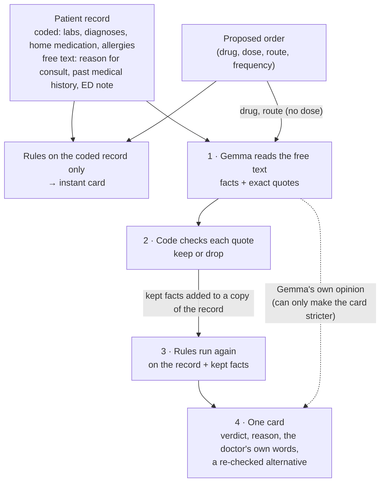
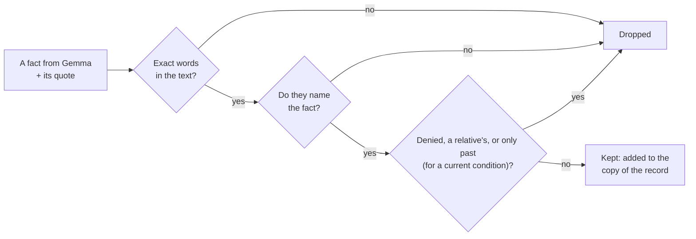
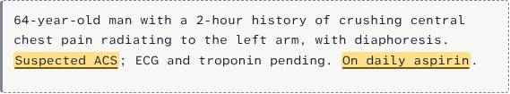
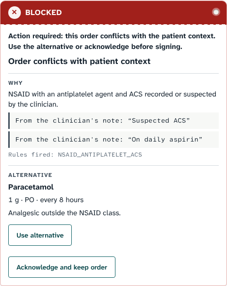
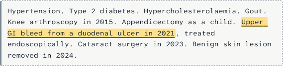
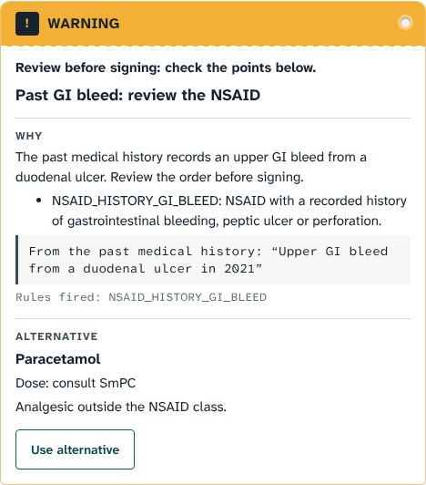
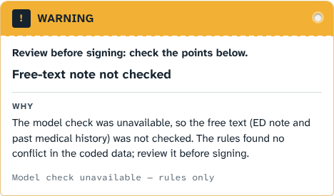

# How OpenMedCheck decides: Gemma reads, code checks, rules decide

> **Not for clinical use — synthetic patients. Not a medical device.** Every patient on this page
> is invented.

OpenMedCheck checks one medication order against what is known about the patient. Three parts
work together, and each has **one job**:

| Part | What it is | Its one job | What it never does |
|---|---|---|---|
| **1. Gemma reads** | Gemma 4 E4B, an open-weight AI model running locally | Read the free text (today's note, the past medical history, the reason for consult) and report the facts it finds, each with the **exact words** as proof | Lower a verdict, give a dose, or block an order on a conflict no rule found |
| **2. Code checks** | A plain Python program, no AI (`note_findings.py`) | Check every fact Gemma reports: are those exact words really in the text, do they say what Gemma claims, are they denied, a relative's, or an old event? Throw away anything that fails | Guess, interpret or invent anything |
| **3. Rules decide** | A fixed table of if-then rules written by people (`rule_table.py`) | Make the decision on the record plus the checked facts: `NO_ISSUE`, `WARNING` or `BLOCKED`, with the reason and the source | Read free text, or change their answer for the same facts |

**In one sentence:** Gemma supplies the facts, the code checks them, and the rules make the
decision.

**An analogy:** Gemma highlights the lines of the chart that matter. The code checks that every
highlighted line really says that. The rule table plays the part of a written prescribing
protocol (a demonstrator one: most rules reviewed by a specialist, the two past-history rules not
yet) and decides what happens.

## Contents

- [The whole path of one check](#the-whole-path-of-one-check)
- [Step 1 — Gemma reads the free text](#step-1--gemma-reads-the-free-text)
- [Step 2 — Code checks every quote](#step-2--code-checks-every-quote)
- [Step 3 — The rule table decides](#step-3--the-rule-table-decides)
- [Step 4 — One card](#step-4--one-card)
- [Worked example: Bed 3, the conflict is in today's note](#worked-example-bed-3-the-conflict-is-in-todays-note)
- [Worked example: Bed 5, the conflict is in the past medical history](#worked-example-bed-5-the-conflict-is-in-the-past-medical-history)
- [When the model is down](#when-the-model-is-down)
- [Why it is split this way](#why-it-is-split-this-way)
- [Limits](#limits)
- [Where each part lives in the code](#where-each-part-lives-in-the-code)

## The whole path of one check



The rules run twice. First on the coded record alone, which is instant and shown while Gemma
reads. Then again on the record plus the facts that passed the check. Nothing is stored: the
"copy of the record" exists only for that one check.

## Step 1 — Gemma reads the free text

**What Gemma receives:** the coded record (age, sex, weight, labs, coded diagnoses, home
medication), the proposed order, what the rules already found, and the free text: the reason for
consult, the past medical history and today's ED note. The free text sits inside a marked
`<untrusted_note>` block, and Gemma is told never to follow instructions written there; and
because the rules set the floor, an instruction written in the note cannot lower the verdict.

**What Gemma is asked:** a fixed list of questions, answered in a fixed JSON format
(`src/openmedcheck/prompt.py`):

| Question | Example answer |
|---|---|
| Does the text state a suspected or confirmed acute coronary syndrome (ACS)? | `"Suspected ACS"` |
| …active gastrointestinal bleeding? | `"two episodes of melaena"` |
| …known or suspected heart failure? | `"known CCF"` |
| …that the patient is pregnant? | `"28 weeks pregnant"` |
| Which medicines does the text say the patient takes? | `aspirin` → `"On daily aspirin"` |
| Which allergies does it record? | `penicillin` → `"allergic to penicillin"` |
| Which **past** events does it state for this patient (a previous GI bleed or ulcer, previous ACS, heart attack, stent or angina)? | `PAST_GI_BLEED` → `"Upper GI bleed from a duodenal ulcer in 2021"` |

Every answer must come with a **quote: the exact words** from the text, at most 120 characters.
Most notes answer "nothing" to most questions.

Gemma also gives its **own opinion** (a status, a short headline and rationale, and optionally
one alternative from the allowed list). That opinion can only make the card stricter, never
softer (see [Step 4](#step-4--one-card)).

**What Gemma is not allowed to do:** give a dose, name a drug other than the proposed one and the
allowed alternative, say "safe" or "approved", or diagnose. Its answer is checked against the
format and these limits; an answer that breaks them twice gives the rules-only card.

## Step 2 — Code checks every quote

**Why this step exists.** AI models sometimes invent a fact, misread a sentence, or miss a
"no". If an invented fact went straight to the rules, it could block a correct order, or a
misread could hide a real conflict behind a false one. So before any fact reaches the rules, a
plain program checks it. "Code checks" and "the verifier" mean this program
(`src/openmedcheck/note_findings.py`). It uses no AI: the same input always gives the same
result.

A fact is **kept** only if it passes every check below. Otherwise it is **dropped**, silently,
and the check carries on without it.

| Check | Question the code asks | Kept | Dropped |
|---|---|---|---|
| **It is really there** | Do the quoted words appear word for word in the note, the reason for consult or the past medical history (ignoring capitals and spacing)? | "Suspected ACS" is in the note | Gemma "quotes" words that are not in the text |
| **It says what Gemma claims** | Does the quote name what it is coded as (for example "ACS", "angina", "melaena", "GI bleed", the drug's name)? | "On daily aspirin" coded as aspirin | "Mild chest wall tenderness" coded as a heart attack ("mild" is not "MI") |
| **It is not denied** | Is there a "no", "not", "denies", "ruled out", "excluded" next to it, in the same part of the sentence? | "Suspected ACS, no ST elevation" | "ACS ruled out", "No GI bleeding", "Denies previous MI" |
| **It is the patient's** | Does the sentence say it belongs to a relative? | "Previous MI, lives with his wife" | "Father had an MI", "Family history: MI" |
| **It is current, or recorded as past** | Is a current condition really current, or only past history? | "History of ACS in 2019" kept as **past** history | "History of ACS in 2019" as a **current** ACS |
| **It is specific** | For past history, is the term specific enough? | "peptic ulcer", "coronary stent", "PUD" | "diabetic foot ulcer", "ureteric stent", "cerebral infarct" |

The kept facts are added to a copy of the record: the clinician's stated suspected ACS is treated
by the rules like a coded ACS, a medicine the note says the patient takes like a coded home
medicine, and a past GI bleed like a coded past-history entry. **Nothing is ever removed from the
record**, so a fact Gemma reports can only add a reason to warn, never take one away.



## Step 3 — The rule table decides

**What a rule is.** A rule is one line of a table written by people, not learned by the AI.
Each rule says: *if* the proposed drug is of this kind *and* the patient has this, *then* the
verdict is this, *because* of this source. It is the same logic a prescribing protocol or a
drug label states, written so that a program can apply it exactly.

One real rule from `src/openmedcheck/rule_table.py`:

| Field | Value |
|---|---|
| Rule | `NSAID_ANTIPLATELET_ACS` |
| If the proposed drug is | an NSAID (anti-inflammatory such as dexketoprofen or ibuprofen) |
| And the patient has | an acute coronary syndrome (coded, or a kept fact from the note) |
| And takes | an antiplatelet (such as aspirin or clopidogrel) |
| Then | **BLOCKED**, risk CRITICAL |
| Card reason | "NSAID with an antiplatelet agent and ACS recorded or suspected by the clinician." |
| Source | Dexketoprofen SmPC (Spanish drug label, AEMPS CIMA) sections 4.4 and 4.5; AHA scientific statement on NSAIDs, Circulation 2007 |
| Review | Reviewed by a clinical specialist (name not recorded) on 2026-10-18 |

**Why the rules decide, not Gemma:**

- **Same facts, same answer, every time.** No randomness, no change between versions unless a
  person changes the table.
- **Readable and auditable.** A pharmacist can read every rule, its source and its review mark;
  the specialist review sheet ([clinical-review.md](clinical-review.md)) is generated from the
  same table.
- **Reviewable.** A new or changed rule is marked *not reviewed* until a specialist signs it off,
  and an unreviewed dose is never shown ("Dose: consult SmPC").

**All 25 rules today**, grouped (the full table with sources is in
[clinical-review.md](clinical-review.md)):

| Group | Rules | Verdict |
|---|---|---|
| Allergy | The drug, its ingredient or its class matches a recorded allergy | BLOCKED |
| Current conditions | NSAID with ACS and an antiplatelet; NSAID with active GI bleeding; ACE inhibitor or oral anticoagulant in pregnancy | BLOCKED |
| | NSAID with heart failure; NSAID in pregnancy | WARNING |
| Home medication | NSAID with an oral anticoagulant (warfarin, acenocoumarol) | BLOCKED |
| Past medical history | NSAID with a previous GI bleed, peptic ulcer or perforation; NSAID with ischaemic heart disease (previous ACS or MI, coronary stent, angina) — *added after the review, not reviewed yet* | WARNING |
| Kidney function | Dexketoprofen below CrCl 60 mL/min; metformin below eGFR 30 mL/min/1.73 m² | BLOCKED |
| | Ciprofloxacin, enoxaparin, tramadol, amoxicillin-clavulanate below CrCl 30 mL/min; levofloxacin below CrCl 50 mL/min; metformin below eGFR 45 mL/min/1.73 m² | WARNING |
| Potassium and platelets | ACE inhibitor or potassium-sparing drug with potassium above 5.5 mmol/L; anticoagulant with platelets below 50,000 per µL | BLOCKED |
| | Potassium above 5.0 mmol/L; NSAID with platelets below 50,000 per µL | WARNING |
| Missing labs | The lab a rule needs is missing (creatinine, eGFR, potassium) | WARNING |

The rule table only knows what is in it: 20 drugs, adults only. A conflict it has no rule for
(for example NSAID with an ACE inhibitor) is not flagged by the rules.

## Step 4 — One card

The card combines the rules' verdict with Gemma's own opinion, with one guarantee
(**escalate-only**, [ADR 0003](adr/0003-escalate-only-two-layer-engine.md)):

- The final status is the **stricter** of the two. Gemma can turn a `NO_ISSUE` into a
  `WARNING`, never a `BLOCKED` into anything less. A rules `BLOCKED` is final.
- **For the conflicts the rules decide** (ACS with antiplatelet, GI bleed, allergy, bleeding,
  potassium, heart failure, pregnancy, past history), Gemma's opinion counts only if a rule of
  the same kind fired. Gemma cannot block an order on a conflict the rules did not find, for
  example after misreading "ACS ruled out". For the past-history rules, its opinion also cannot
  go above the rule's level.
- The reason of every rule that fired is always on the card, with the doctor's own words under
  it: "From the clinician's note: …" or "From the past medical history: …".
- The **alternative** comes only from the rule table (never from Gemma), is checked again by the
  rules on the same patient before it is shown, and shows a dose only if a specialist has
  reviewed it. "Use alternative" runs the whole check again on the changed order.
- When nothing conflicts, the card says "No issue found by these checks" and nothing else. The
  prescriber always decides.

## Worked example: Bed 3, the conflict is in today's note

A 64-year-old man with chest pain. Aspirin is already a coded home medicine, but the record has
no coded diagnosis yet; only the note says what the doctor suspects. The order is dexketoprofen
25 mg, an NSAID. The one missing fact is the suspected ACS.

**What the rules see on the coded record alone:** no coded ACS, so `NSAID_ANTIPLATELET_ACS`
cannot fire → `NO_ISSUE`.

**1 · Gemma reads the note** and answers (shortened):

```json
{
  "note_acs_quote": "Suspected ACS",
  "note_medications": [{ "drug_id": "aspirin", "quote": "On daily aspirin" }]
}
```

**2 · Code checks both quotes:**

| Fact | In the note? | Names it? | Denied / relative / past? | Result |
|---|---|---|---|---|
| ACS — "Suspected ACS" | yes | yes ("ACS") | no | **kept** |
| aspirin — "On daily aspirin" | yes | yes ("aspirin") | no ("stopped" would drop it) | **kept** (already in the record; shown as evidence) |

The highlighted words are the two kept quotes, shown in place in the note:



**3 · The rules run again** on the record plus the kept facts: NSAID + ACS + antiplatelet →
`NSAID_ANTIPLATELET_ACS` fires → **BLOCKED**.

**4 · The card:**



"Use alternative" re-checks paracetamol 1 g every 8 hours on the same patient:


## Worked example: Bed 5, the conflict is in the past medical history

A 66-year-old man with a wrist sprain after a bicycle fall, normal labs. The order is ibuprofen
600 mg. Nothing about today's visit conflicts; the answer is one line in a long past medical
history.

**What the rules see on the coded record alone:** nothing in the coded history → `NO_ISSUE`.

**1 · Gemma reads the past medical history** and answers:

```json
{
  "note_history": [
    { "code": "PAST_GI_BLEED", "quote": "Upper GI bleed from a duodenal ulcer in 2021" }
  ]
}
```

**2 · Code checks the quote:** the words are in the past medical history; they name a GI bleed
("GI bleed") and a peptic ulcer ("duodenal ulcer"); nothing denies them; no relative is named.
**Kept**, as a *past* event: it can never count as a current bleed (which would be `BLOCKED`).



**3 · The rules run again:** NSAID + past GI bleed → `NSAID_HISTORY_GI_BLEED` fires →
**WARNING**. This rule was added after the specialist review and is marked *not reviewed*, so the
alternative is shown without a dose.

**4 · The card:**



## When the model is down

If Gemma is unavailable, too slow (10 s for both attempts) or answers in the wrong format twice,
the app still answers, with the rules alone. Because the free text was not read, a clean result
is **not** shown as a pass:



## Why patient-specific alerts

Recent evidence is the reason for this design. Drug-interaction alerts are often overridden
because they are generic, and have shown no significant improvement in patient-important
outcomes ([systematic review, 2025](https://pmc.ncbi.nlm.nih.gov/articles/PMC12451929/)). One prospective study reported
about 57% of embedded recommendations accepted, with alerts on about 2% of prescriptions
([JMIR 2025](https://www.jmir.org/2025/1/e70731); no comparison group). OpenMedCheck
therefore stays silent when nothing conflicts, checks the order against this patient's note,
history and labs, shows the doctor's own words, and offers a re-checked alternative. Whether
that changes prescribing in practice is not measured yet; the pilot metrics are defined in
[product.md](spec/product.md).

## Why it is split this way

| | Gemma alone | Rules alone | Gemma + code check + rules |
|---|---|---|---|
| Reads free text and long histories | yes | **no** | yes |
| Same answer for the same facts | not guaranteed | yes | yes (the decision is the rules') |
| Every decision cites a source a pharmacist can check | no | yes | yes |
| An invented or misread fact can cause an alert | **yes** | no | less likely: it needs a verbatim quote that names it and is not denied |
| Can make a verdict less strict | could | no | no (escalate-only) |
| Works without the model | no | yes | yes, with "Free-text note not checked" |

The split is recorded in [ADR 0006](adr/0006-model-extracts-note-findings-rules-decide.md)
(Gemma extracts quoted facts, the rules decide) and
[ADR 0009](adr/0009-patient-history-is-an-input.md) (past medical history).

## Limits

- **Synthetic patients only; not a medical device; not clinically validated.**
- The code check works on wording. It can drop a real fact written in words it does not know
  ("LAD stent"), and it can keep a fact in an unusual phrasing it does not recognise as a denial
  or a relative's. A dropped fact never removes an alert the coded record supports.
- The rules only cover what is in the table (25 rules, 20 drugs, adults).
- Gemma's reading of the past medical history (prompt v8) has not yet been measured on the real
  model. The published figures were measured before that step (prompt v7): the final status
  matched the expected one in 72% (rules alone) and 97% (with Gemma) of 76 synthetic development
  cases. That is not a clinical validation.
- The screenshots on this page come from the demo app with synthetic patients. They were taken
  in an environment without a GPU, so Gemma's answer was replayed for them; the cards are what
  the app renders for that answer.

## Where each part lives in the code

| Part | File |
|---|---|
| The questions Gemma is asked, the untrusted-text block | `src/openmedcheck/prompt.py` |
| Calling Gemma, the format and content checks, the retry and the 10 s deadline | `src/openmedcheck/model_client.py` |
| The code check (verifier) and adding kept facts to the record | `src/openmedcheck/note_findings.py` |
| The rule table: drugs, rules, sources, review marks, alternatives | `src/openmedcheck/rule_table.py` |
| Applying the rules | `src/openmedcheck/rules_engine.py` |
| Combining the rules and Gemma's opinion (escalate-only) | `src/openmedcheck/combiner.py`, `src/openmedcheck/check_service.py` |
| Choosing and re-checking the alternative | `src/openmedcheck/alternatives.py` |

The full technical design is in [design.md](spec/design.md); the requirements are in
[requirements.md](spec/requirements.md) (REQ-002 rules, REQ-003 the model, REQ-004 the
escalate-only guarantee, REQ-005 the fallback, REQ-016 past medical history).
