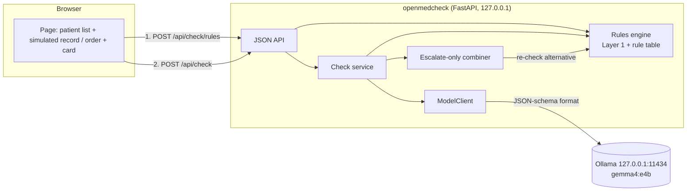
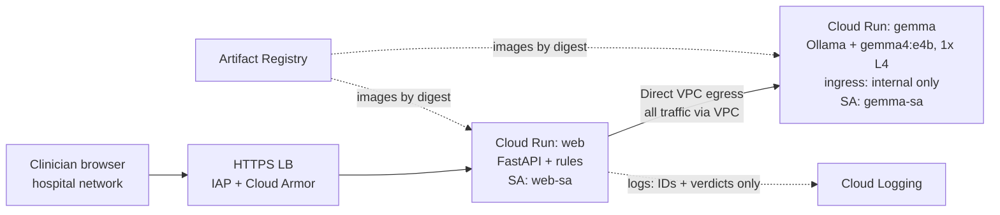

# Design: OpenMedCheck

- Status: Approved <!-- Draft | In review | Approved -->
- Last updated: 2026-10-17
- Implements: requirements.md (REQ-001 … REQ-014, NFR-001 … NFR-012)

## Overview
One local Python process (FastAPI) serves the page, the static assets and a JSON API. Each
check runs the deterministic **rules engine** first (Layer 1). The browser shows that card
straight away. The **check service** then asks a local **Ollama** server running Gemma 4 E4B
(Layer 2) for a schema-constrained verdict, validates it and merges it with the rules verdict in
a pure, **escalate-only combiner**. Any model alternative is re-checked by the rules before it is
shown. If the model is slow, down or wrong twice, the rules card is final. Nothing is stored;
logs carry no patient data. The GCP deployment is a documented plan only (§ GCP reference
architecture).

## Options considered
| Decision | Options | Chosen | ADR |
|---|---|---|---|
| App and UI | FastAPI + Jinja2 + vanilla JS · FastAPI + React SPA · Streamlit/Gradio | FastAPI + Jinja2 + vanilla JS: one toolchain, testable API, no CDN | [0002](../adr/0002-local-fastapi-app-with-server-rendered-ui.md) |
| Safety engine | Rules → model → escalate-only combiner · model decides with rule veto · rules only | Escalate-only combiner, rules-only as fail-safe | [0003](../adr/0003-escalate-only-two-layer-engine.md) |
| Model serving | Ollama + JSON schema · vLLM · llama.cpp + GBNF · hosted API | Ollama `gemma4:e4b`, `httpx`, no SDK | [0004](../adr/0004-serve-gemma-4-e4b-locally-with-ollama.md) |
| Cloud target | Cloud Run + L4 internal · same + min=1 · Vertex + PSC · GCE spot · hosted API | Cloud Run + L4 internal, **documented only** | [0005](../adr/0005-gcp-reference-architecture-documented-only.md) |
| Progressive display | Two API calls · one call with SSE/streaming | Two calls: `/api/check/rules` (instant), `/api/check` (final, recomputes rules server-side). No streaming (REQ-008) | — (minor) |
| Rule table format | Python module of typed dataclasses · YAML + schema | Python module: mypy-checked, no YAML dependency; a script renders it to Markdown for the specialist | — (minor) |

## Components
| Component | Responsibility | Tech | Requirements |
|---|---|---|---|
| `contracts` | Pydantic models for PatientContext, Order, RulesVerdict, ModelVerdict, DecisionCard, problem details; range validation | Pydantic v2 | REQ-001, AC-001.4 |
| `renal` | Cockcroft-Gault CrCl from age, weight, sex, creatinine | Pure Python | AC-002.7 |
| `rule_table` | Drug list (~15), drug classes, renal thresholds, contraindication rules, allowed alternatives with rule-table doses, source citations, review marks | Python module (data) | REQ-002, NFR-011 |
| `rules_engine` | Applies all rules to a context + order → RulesVerdict; no I/O | Pure Python | REQ-002, AC-001.5, REQ-005 |
| `prompt` | Versioned system prompt + per-request user message; note is delimited as untrusted data; card JSON schema built per request (alternative enum = allowed alternatives for this drug) | Python | REQ-003, AC-003.5 |
| `model_client` | `ModelClient` protocol; `OllamaClient` (httpx, `/api/chat`, `format`=schema, temperature 0, timeout); `FakeModelClient` for tests | httpx | REQ-003, REQ-005, NFR-004 |
| `combiner` | Pure escalate-only merge of RulesVerdict + ModelVerdict; text-source selection; flags union | Pure Python | REQ-004 |
| `check_service` | Orchestrates rules → model (validate, retry once) → combine → alternative re-check → DecisionCard; timing; one log line | Python | REQ-001, REQ-003–005, NFR-007 |
| `presets` | Synthetic presets A, B, C | Python data | REQ-006 |
| `web` | FastAPI app, routes, Jinja2 template, static CSS/JS, trusted-host and body-size middleware, model health/warm-up | FastAPI, Jinja2, uvicorn | REQ-007–011, REQ-014, NFR-001 |
| `logging_setup` | JSON log formatter, allowlisted fields only | stdlib `logging` | NFR-002, NFR-007 |
| `config` | Reads and validates environment variables | stdlib + explicit validation | AC-011.3 |
| `scripts/measure.py` | 20+ calls over presets → p50/p95, valid-output rate → `docs/measurements/` | Python | REQ-012, NFR-004, NFR-012 |
| `scripts/render_rule_table.py` | Rule table → `docs/clinical-review.md` table for the specialist | Python | NFR-011 |

## Data model
No persistence. All data is synthetic, in memory for one request only, classified as
**special-category health data (treated as if real)** for logging and exposure rules (NFR-002).

- **PatientContext**: `patient_id` (synthetic label), `age` (18–110), `sex` (`M`/`F`),
  `weight_kg` (30–250), `reason_for_consult` (≤ 200 chars), `ed_note` (free text, ≤ 2,000 chars),
  `diagnoses[]` (coded, from a small fixed list, e.g. `ACS`, `ACTIVE_GI_BLEED`),
  `chronic_medications[]` (drug IDs from the drug list), `allergies[]` (active ingredient or
  class IDs), `labs`: `creatinine_mg_dl` (0.1–20, optional), `egfr_ml_min_1_73m2` (0–200,
  optional), `potassium_mmol_l` (1.5–9, optional), `platelets_per_ul` (1,000–2,000,000,
  optional).
- **Order**: `drug_id` (drug list), `dose_text`, `route` (`PO`/`IV`/`IM`/`SC`), `frequency`.
- **RulesVerdict**: `status`, `risk_level`, `fired_rules[]` (`rule_id`, fixed `reason`),
  `renal_adjustment_required`, `crcl_ml_min` (if computed), `rule_alternative` (or none).
- **ModelVerdict** (validated model output): `status`, `risk_level`, `headline` (≤ 8 words),
  `rationale` (≤ 2 sentences, ≤ 300 chars), `renal_adjustment_required`, `conflict_type`
  (enum, required when it escalates), `alternative_drug_id` (enum of allowed alternatives for
  this drug, or null). The model never supplies a dose; doses come from the rule table. After
  schema validation, a content check rejects dose patterns, other drug-list names and banned
  words in the headline/rationale (AC-003.5).
- **DecisionCard**: `status`, `risk_level`, `headline`, `rationale`, `fired_rules[]`,
  `renal_adjustment_required`, `crcl_ml_min`, `alternative` (`drug_id`, display name,
  `dose_text`, `route`, `frequency`, `reason`) or null, `source` (`rules` / `rules+model`),
  `model_note` (e.g. "Model check unavailable — rules only"), `request_id`.
- **Rule table entry**: `rule_id`, applies-to (drug IDs or classes), condition, resulting
  `status`/`risk_level`, `conflict_type`, `reason`, `source` (citation URL/text),
  `reviewed_by`/`reviewed_on` (or null → numeric doses suppressed).
- **Allowed alternatives**: keyed by (proposed drug, conflict type) → ordered list of
  (`drug_id`, `dose_text`, `route`, `frequency`, `source`, review mark). Example: (dexketoprofen,
  `ANTIPLATELET_ACS`) → paracetamol. An alternative with an unreviewed dose is offered by name
  only, with "Dose: consult SmPC" (no numeric dose).

Candidate drug list (final list set during the clinical review, Q-5): NSAIDs (dexketoprofen,
ibuprofen, naproxen, diclofenac); other analgesics (paracetamol, metamizole, tramadol, morphine);
antibiotics (ciprofloxacin, levofloxacin, amoxicillin-clavulanate); antiplatelets as home
medication (aspirin, clopidogrel); plus enoxaparin and metformin. All thresholds and doses
come from the cited SmPC, not from this document. [ASSUMPTION A-7]

## Interfaces
JSON over HTTP on `127.0.0.1:${OPENMEDCHECK_PORT}`. Errors use RFC 9457
`application/problem+json` with field-level `errors[]`. Version: unversioned `/api/*` for v0.1
(local only, single client).

| Method + path | Purpose | Response |
|---|---|---|
| `GET /` | Page (banner, chart, card area) | HTML |
| `GET /api/drugs` | Drug list for the dropdown | `[{drug_id, name, active_ingredient, class}]` |
| `GET /api/presets`, `GET /api/presets/{id}` | Synthetic presets | PatientContext + Order |
| `POST /api/check/rules` | Layer 1 only, instant card | DecisionCard with `source=rules` |
| `POST /api/check` | Full check (rules + model + combiner) | DecisionCard |
| `GET /api/model/health` | `ready` / `warming` / `unavailable` + model tag | JSON |
| `POST /api/model/warmup` | One warm-up call (REQ-014) | 202 |

Request body for both checks: `{ "context": PatientContext, "order": Order }`. Status codes:
200 card · 413 body > 16 KB · 415 not JSON · 422 validation error (fields listed) · 500 only for
bugs (never for model failures, which return a rules-only 200).

Ollama call: `POST ${OPENMEDCHECK_OLLAMA_URL}/api/chat`, `stream=false`, `format=<card schema>`,
`options.temperature=0`, `keep_alive` long enough to stay warm between demo calls.

Configuration (environment variables, defaults): `OPENMEDCHECK_HOST=127.0.0.1`,
`OPENMEDCHECK_PORT=8000`, `OPENMEDCHECK_OLLAMA_URL=http://127.0.0.1:11434`,
`OPENMEDCHECK_MODEL=gemma4:e4b`, `OPENMEDCHECK_MODEL_TIMEOUT_S=10` (total deadline across the
attempt and the retry), `OPENMEDCHECK_ALLOW_NONLOCAL=0` (the app refuses to start with a
non-loopback host or Ollama URL unless set; AC-011.4).

## Check flow and the invariant
1. Validate input (Pydantic) → 422 on error, nothing evaluated.
2. Rules engine → RulesVerdict (also returned alone by `/api/check/rules`).
3. Build prompt (system prompt + context + order + rules verdict + allowed alternatives); call
   the model with the per-request schema; validate schema, then content (AC-003.5); retry once
   on invalid. One 10 s deadline covers both attempts; on expiry → fallback.
4. Combiner (pure):
   - status = max(rules, model); risk = max(rules, model); renal flag = rules OR model; if the
     renal flag is set, status = max(status, `WARNING`).
   - Strictness compares status, then tier. Text: if the model verdict is at least as strict as
     the rules verdict, use the model's headline/rationale; otherwise use the rules text and set
     `downgrade_rejected=true`. If the final status is `NO_ISSUE`, use the fixed headline "No
     issue found by these checks" and no model text (AC-004.9).
   - `fired_rules[]` from the rules are always copied to the card.
   - Deciding conflict type = the fired rule's (highest-status rule) if the rules set the final
     status, else the model's.
5. Alternative (AC-004.6): candidates = [model alternative, then the rule table's alternatives
   for (proposed drug, deciding conflict type)]. A candidate qualifies only if it is on that
   allowed list, is outside the proposed drug's class when the model raised the status, and
   its rewritten order re-run through Layer 1 returns `NO_ISSUE` (or `WARNING` with a reviewed
   rule-table dose). First qualifying candidate is shown, else none; an unreviewed dose is
   shown as "Dose: consult SmPC" with no numeric value.
   Never for `NO_ISSUE` cards.
6. Model unavailable at step 3 → card = rules verdict, `source=rules`, `model_note` = the
   fallback note "Model check unavailable — rules only".

UI (AC-008.7): each evaluation gets a client request ID; "Sign order" is disabled while
"Checking context…" is shown; responses for an older request ID are dropped.

## Security design
- Identities: none. Local single-user tool; no accounts (non-goal).
- IAM: n/a locally; see the GCP reference architecture for the documented target.
- Secrets: none required. No API keys (local Ollama). Nothing to put in Secret Manager.
- Network exposure: uvicorn binds `127.0.0.1` only. `TrustedHostMiddleware` allows only
  `127.0.0.1`/`localhost` (DNS-rebinding defence). No CORS headers; API requires
  `Content-Type: application/json` (a cross-site form post can't send it without a preflight).
  The only outbound connection is to the configured Ollama URL (NFR-001).
- Data protection: synthetic data; nothing persisted; logs allowlist (request ID, preset ID,
  rule IDs, statuses, timings, model outcome); no request bodies, 422 bodies or raw model output
  in any log; uvicorn access log off or reduced to method/path/status.
- Config guard: non-loopback bind host or Ollama URL refused at start-up unless
  `OPENMEDCHECK_ALLOW_NONLOCAL=1` (prevents accidental exposure or egress).
- Output encoding: Jinja2 autoescape on; JS inserts all model and user text with `textContent`.
- Supply chain: runtime deps limited to fastapi, uvicorn, jinja2, httpx, pydantic; dev adds
  hypothesis; pinned in `uv.lock`; `pip-audit` in CI; no CDN assets.
- Threats considered:
  | Threat | Mitigation |
  |---|---|
  | Prompt injection in `ed_note` asks the model to approve | Escalate-only combiner (model can't lower the verdict); note delimited as data; injection test (AC-004.8) |
  | Model invents a drug or dose | Alternative is an enum of allowed IDs per conflict type; doses only from the rule table; Layer 1 re-check; same-class alternatives excluded when the model escalated; dose patterns and other drug names in model text → invalid |
  | Model output with HTML/script (XSS) | Autoescape + `textContent`; XSS test |
  | Malicious website calls the local API (CSRF / DNS rebinding) | Trusted-host check, JSON-only content type, no CORS; no state to change |
  | Health data leaks into logs | Allowlisted log fields; log-capture test (NFR-002) |
  | Oversized input / resource exhaustion | 16 KB body limit, field length limits, model timeout |
  | Clinically wrong rule shown as authoritative | Source citation + specialist review mark per rule; unreviewed doses suppressed; "No issue found by these checks" wording; banner |

## Reliability and operations
- Failure modes and handling:
  | Failure | Behaviour |
  |---|---|
  | Ollama not running / model not pulled | Health shows `unavailable`; checks return rules-only cards |
  | Model slow (> timeout) | Rules-only card; `model_outcome=timeout` |
  | Invalid JSON / schema violation | Retry once, then rules-only; `model_outcome=invalid` |
  | Model tries to downgrade | Rules verdict kept; `downgrade_rejected=true` |
  | Bug in the app | 500 with problem details, no body logged |
- Observability: one JSON log line per check (NFR-007) to stdout; `scripts/measure.py` for
  latency and validity (REQ-012). No metrics backend locally.
- Backups / recovery: none needed (no state).

## Environments and deployment
- **v0.1 (this version):** local only. `ollama pull gemma4:e4b` → `uv sync` →
  `uv run openmedcheck` → open `http://127.0.0.1:8000`. CI (existing GitHub Actions) runs
  lint, type check, unit/API tests with the fake model, and pip-audit; tests needing a real model
  are marked `ollama` and run locally only.
- **Cloud:** documented plan only (below). Not implemented (AC-013.3).

## GCP reference architecture (documented, not implemented)
**Not implemented in v0.1** (REQ-013, AC-013.3): nothing in this section exists as code,
Terraform or cloud resources, and the app has no cloud SDK calls (NFR-006). It was reviewed against
the code on `dev` (`config.py`, `web.py`, `model_client.py`, `logging_setup.py`, `__main__.py`)
on 2026-10-17; the gaps between the code and this plan are listed under "Code changes this plan
needs", and each needs a spec change before anyone builds it.

Target for a hospital's own GCP tenancy, europe-west1, one project per environment
(`openmedcheck-dev`, `openmedcheck-prod`).

- **web**: Cloud Run service, the same container as local. Ingress
  `internal-and-cloud-load-balancing` behind an HTTPS load balancer with IAP (staff identities)
  **and** Cloud Armor (gcp.md: no public ingress without Cloud Armor). No `allUsers` invoker
  binding for users: `roles/run.invoker` on `web` goes only to the IAP service agent
  (`service-<project number>@gcp-sa-iap.iam.gserviceaccount.com`), and
  `roles/iap.httpsResourceAccessor` on the IAP-protected backend service goes to a clinician
  Google group (never individual users). Egress: Direct VPC egress, all traffic through a
  custom-mode VPC with no NAT, so the app cannot reach the public internet. This is not
  "zero egress" in the strict sense: with Private Google Access, `web` can still reach Google
  APIs and any Cloud Run service, and a firewall cannot filter by service behind that address.
  For real patient data, the zero-egress claim therefore requires a VPC Service Controls
  perimeter with the `restricted.googleapis.com` addresses (`run.googleapis.com` and
  `logging.googleapis.com` inside the perimeter). Load balancer: Google-managed certificate,
  SSL policy with minimum TLS 1.2, HTTP-to-HTTPS redirect, reserved static IP. Cloud Armor
  policy: default deny, allow only the hospital's egress IP ranges, preconfigured WAF rules
  (SQLi/XSS) in preview mode first.
  Probes: do **not** probe `/api/model/health` (it reports the model state, and `web` must stay
  up, rules-only, when the model is down, REQ-005). Use a TCP startup probe (the Cloud Run
  default); add an HTTP liveness probe on `GET /` only after confirming which `Host` header the
  probe sends, because `TrustedHostMiddleware` would answer 400 to an unexpected one (see the
  trusted-hosts row below).
- **gemma**: Cloud Run service with 1 NVIDIA L4, Ollama with the model weights baked into the
  image (no download at start), `OLLAMA_HOST=0.0.0.0:<container port>` so Ollama listens on the
  Cloud Run port instead of its loopback default, ingress `internal`, invoker role granted only
  to `web-sa`, `max-instances=1`, `min-instances=0` (demo) or `1` (production), concurrency =
  `OLLAMA_NUM_PARALLEL`. Cloud Run GPU services use instance-based billing (the mode the L4 prices
  below are quoted in). `gemma` also uses Direct VPC egress with all traffic through the same
  NAT-less subnet: the weights are baked in, so it needs no outbound access, and it is the service
  that receives the patient context. `OLLAMA_DEBUG` must be unset or `0` (debug logging prints
  prompts, which hold the note and labs). Ollama's management endpoints (`/api/pull`,
  `/api/delete`, `/api/create`) are reachable by any invoker; only `web-sa` is one. Production
  chooses zonal redundancy or not explicitly (both are priced below); with `max-instances=1` the
  model layer is a single point of failure, which the rules-only fail-safe tolerates.
- **Identities:** `web-sa` (`roles/run.invoker` on `gemma` only); `gemma-sa` (no project roles;
  whether Cloud Run stdout logging needs a log-writer role is not verified here, so grant none
  unless the documentation says it is needed). Image pulls use the Cloud Run service agent, not
  these accounts (grant it `artifactregistry.reader` if Artifact Registry is in another project).
  No key files. CI deploys through Workload Identity Federation with `roles/run.developer`,
  `roles/iam.serviceAccountUser` on `web-sa` and `gemma-sa` only (not project-wide) and
  `roles/artifactregistry.writer` on the one repository. One owner for the image reference:
  Terraform (a variable updated by a CI pull request), or `lifecycle { ignore_changes }` on the
  image if CI deploys digests, so the two do not drift.
- **Network:** custom VPC + subnet in europe-west1, Private Google Access on. A deny-all egress
  firewall would also block the path to `*.run.app`, so the plan is: a private DNS zone `run.app.`
  with a wildcard A record to `private.googleapis.com` (199.36.153.8/30; `restricted.googleapis.com`,
  199.36.153.4/30, once VPC Service Controls is on); an egress allow rule for tcp:443 to that /30
  at a higher priority (lower number) than the deny-all `0.0.0.0/0` rule; the default internet
  route kept so the addresses are reachable. That Direct VPC egress traffic is subject to these
  firewall rules and that `web` reaches an internal-ingress `gemma` this way are the main risks to
  verify (idea brief section 6).
- **Encryption:** Google-managed keys by default; TLS on both hops (client to load balancer, and
  `web` to `gemma` over HTTPS to `run.app` with certificate verification on in `httpx`); CMEK for
  Artifact Registry and logs only if the hospital's compliance requires it.
- **Data:** no storage of context. `web` writes one JSON line per check to stdout with the
  fields in `logging_setup.ALLOWED_FIELDS` (that constant is the list). The platform's own Cloud
  Run request log adds method, path, status, remote IP, user agent and referer, never bodies; the
  staff IP is personal data and IAP data-access logs contain staff emails. Set the log bucket
  location to europe-west1 or EU (the `_Default` bucket is global unless configured). Admin
  Activity audit logs are always on; enable Data Access logs for IAP and Cloud Run explicitly if
  wanted; default retention. For real patient data, add a VPC Service Controls
  perimeter around the project (gcp.md).
- **Cold start:** Google's Cloud Run GPU GA announcement reports a GPU instance ready in under
  5 s and about 19 s to first token from zero for a 4B Gemma (not re-measured here). The app's
  total model deadline is 10 s (`OPENMEDCHECK_MODEL_TIMEOUT_S`, across attempt and retry), so with
  `min-instances=0` the first check after idle will usually time out and return a rules-only
  card (the designed fail-safe, REQ-005); the figure is for a 4B model and a large baked image adds
  pull time, so expect longer. Mitigations: the instant rules card,
  `/api/model/warmup` on page load, and `min-instances=1` in production.
- **Cost:** see "Cost estimate" below. L4 price read on 2026-10-17 (Q-1, closed with a caveat).

### Code changes this plan needs (not implemented; each needs a spec change first)
The shipped app is loopback-only by design (AC-011.3, AC-011.4, NFR-001). Running it on Cloud Run
means deliberately relaxing that:

| Topic | v0.1 behaviour (verified in code) | Documented future change |
|---|---|---|
| Bind host | `OPENMEDCHECK_HOST` default `127.0.0.1`; `Config.validate` refuses any non-loopback host | The Cloud Run service sets `OPENMEDCHECK_HOST=0.0.0.0` and `OPENMEDCHECK_ALLOW_NONLOCAL=1`. Cloud Run only reaches a container listening on all interfaces, so the flag is the explicit, reviewable opt-in. Set it only in the service definition (Terraform), never as an image default or in a `.env` file |
| Port | `OPENMEDCHECK_PORT` (default 8000); the app does not read Cloud Run's `PORT` | Set `OPENMEDCHECK_PORT` to the service's container port in the service definition |
| Trusted hosts | `TrustedHostMiddleware` allows `127.0.0.1`, `localhost`, `[::1]`, plus `config.host` when it is non-loopback and `ALLOW_NONLOCAL=1`. With host `0.0.0.0` that adds the literal `0.0.0.0`, which no real `Host` header matches, so every request through the load balancer would be rejected (400) | Add a configurable trusted-hosts list (for example `OPENMEDCHECK_TRUSTED_HOSTS`, comma-separated) holding the load balancer's DNS name and the service's `run.app` name; keep the DNS-rebinding defence on. Needs a new AC and a test |
| Ollama URL | `OPENMEDCHECK_OLLAMA_URL` must be loopback unless `ALLOW_NONLOCAL=1` | Set to the internal `gemma` service URL (`https://...run.app`); allowed by the same flag |
| Calling `gemma` | `model_client` sends no credentials; `httpx.Client(trust_env=False)` | An invoker-only Cloud Run service needs a Google-signed ID token with the `gemma` URL as audience on every call. Add an optional token provider in `model_client`; it makes the metadata server a second outbound destination, which contradicts NFR-001 ("only the Ollama URL") and its outbound-socket test, so NFR-001 must be amended first, naming the exact destination (`metadata.google.internal` / 169.254.169.254, identity endpoint only). Cache the token (about an hour) so fetching it does not eat into the 10 s deadline |
| Log severity | JSON line carries `level`, `ts`, `logger`, `event` | Cloud Logging reads `severity` and `timestamp`; add them (or map them in the logging agent) so levels and times show correctly. Keep the allowlist unchanged |
| Remote model URL | With `ALLOW_NONLOCAL=1`, `Config.validate` returns early, so any `http(s)` Ollama URL is accepted, including plain-http internet hosts | When non-loopback, require `https` and a host matching `*.run.app` or a configured allowlist (or a separate `OPENMEDCHECK_ALLOW_REMOTE_MODEL` flag). Needs a new AC and a test |
| Health | `GET /api/model/health` is model health, not process health | Do not use it for probes (above) |

On `dev` at the time of this review `web.py` serves `/`, `/api/drugs`, `/api/presets`,
`/api/check/rules`, `/api/check`, `/api/model/health` and `POST /api/model/warmup` (added in
T-008), so the warm-up mitigation above uses shipped code.

### Deployment plan (Not implemented in v0.1)
1. **Prerequisites (human):** create the project, link billing, set a budget with alerts at
   50/90/100% (size it from the Cost estimate, including the fixed costs it lists; budget alerts
   notify, they do not stop spending); request L4 quota in
   europe-west1 on the Quotas page (the default per-region GPU quota, and whether zonal
   redundancy changes it, are not verified here: read the current Cloud Run GPU documentation);
   enable the Run, Artifact Registry, Compute (VPC), Cloud DNS, IAP, IAM, IAM Credentials, STS
   (for Workload Identity Federation), Billing Budgets, Container Scanning and Logging APIs; apply organisation
   policies per gcp.md (no SA keys, restrict public IPs, resource locations).
2. **Code changes** from "Code changes this plan needs", through a spec change and with tests,
   before any image is built.
3. **Terraform to write** (`infra/`, following terraform.md; `envs/dev` and `envs/prod` as
   separate root modules with GCS remote state): `network` (custom VPC, subnet, PGA, private DNS
   zone for `run.app` with the wildcard record, egress allow rule for the Google API /30 at a
   higher priority than the deny-all egress rule); `artifact_registry`; `iam` (`web-sa`,
   `gemma-sa`, invoker bindings for `web-sa` on `gemma` and for the IAP service agent on `web`,
   the clinician group's `iap.httpsResourceAccessor`, CI roles via Workload Identity Federation); `run_gemma` (GPU, internal ingress, min/max instances,
   `OLLAMA_HOST`); `run_web` (Direct VPC egress, `OPENMEDCHECK_HOST=0.0.0.0`,
   `OPENMEDCHECK_ALLOW_NONLOCAL=1`, `OPENMEDCHECK_PORT`, trusted hosts, `OPENMEDCHECK_OLLAMA_URL` =
   gemma URL, ingress via LB); `lb` + IAP + Cloud Armor (policy as above) with `prevent_destroy` on the static IP; log bucket in
   the chosen location; budget; labels `env/app/owner/managed-by=terraform`. `OLLAMA_DEBUG` unset.
4. **Images:** build `web` (this repo) and `gemma` (Ollama base + baked `gemma4:e4b`) in CI,
   push to Artifact Registry, scan, deploy by digest.
5. **Review:** `terraform plan -out=tfplan` -> plan review ->
   the human applies.
6. **Verify:** `gemma` URL unreachable from the internet (403/404); `web` -> `gemma` call works
   over the VPC with an ID token; the revision becomes ready; `web` and `gemma` cannot reach an
   external host; a request with an unexpected `Host` header is rejected; a non-member of the
   clinician group gets 403 from IAP, and the `run.app` URL called directly without a token gets
   403; a `web` and a `gemma` log sample has no context fields or prompt text; run
   `scripts/measure.py` against the deployed URL and compare with NFR-004 (expect the first
   call after idle to be rules-only when `min-instances=0`).
7. **Rollback:** Cloud Run revision traffic shift to the previous revision; `terraform plan`
   for any infra revert (both services are stateless, and `prevent_destroy` protects the static IP
   and the versioned GCS state bucket); to stop GPU spend the human sets `gemma` to zero instances or removes
   the service.

## Testing strategy
| Level | Covers | Tools | Requirements |
|---|---|---|---|
| Unit | Rules engine per rule; Cockcroft-Gault; rule-table lint (citations, review marks, alternatives on the list); combiner (property-based: every status/tier pair, never below rules, renal flag never cleared); alternative re-check; schema validation of model output | pytest, hypothesis | REQ-002, REQ-004, NFR-009, NFR-011 |
| Service | Check service with `FakeModelClient`: escalate, downgrade attempt, invalid ×1 then valid, invalid ×2, timeout, unreachable, unknown drug suggestion, injection note | pytest | REQ-003, REQ-005, AC-004.* |
| API | Endpoints via `TestClient`: 200/413/415/422 shapes, presets A/B/C with a scripted fake model, trusted-host rejection, XSS strings escaped, log capture (no context values; one line per check with NFR-007 fields), outbound-socket guard | pytest, FastAPI TestClient | REQ-001, REQ-006, REQ-011, NFR-001/002/005/007 |
| Wording | Banned words in templates, static JS and README; banner present | pytest | REQ-010, NFR-008 |
| Integration (local, marked `ollama`) | Real `gemma4:e4b`: preset A rules `NO_ISSUE` → final `BLOCKED` in ≥ 9/10 runs; schema validity | pytest `-m ollama` | AC-003.4 |
| Measurement | 20+ calls: p50/p95, valid-output rate | `scripts/measure.py` | REQ-012, NFR-004, NFR-012 |
| Manual / review | UI flow for A/B/C, keyboard-only pass, contrast; usability review | checklist | REQ-007–009, NFR-010 |

Each AC is referenced in the test name or docstring (e.g. `test_ac_004_3_rules_blocked_is_final`).

## Cost estimate
- v0.1: EUR 0 cloud spend (local only, NFR-006). Electricity/hardware are the developer's own.
- Documented cloud target (Not implemented in v0.1); **Q-1 closed with a caveat**.
  - **Source:** Google Cloud, "Cloud Run pricing", https://cloud.google.com/run/pricing, section
    "Services (Instance-based billing)", read 2026-10-17, USD. Quoted rates:
    NVIDIA L4 without zonal redundancy US$0.0001867 per second (US$0.672 per hour); NVIDIA L4
    with zonal redundancy US$0.0002909 per second (US$1.047 per hour); CPU US$0.000018 per
    vCPU-second; memory US$0.000002 per GiB-second.
  - **Caveat:** the page picks the region with a selector. The static page I could read showed
    the default table (Iowa, us-central1); I could not select europe-west1 to confirm it. The
    same page's worked "Example 3" (Ollama on Cloud Run in europe-west1, 4 vCPU, 16 GiB, L4
    without zonal redundancy, up to 2 instances, bell-curve daily traffic) gives US$827.62 a
    month before the free tier (US$822.40 after it), which is consistent with these rates but
    does not prove them for europe-west1. Re-check the europe-west1 row, or the Pricing
    Calculator, before deploying.
  - **Assumptions:** one `gemma` instance of 4 vCPU and 16 GiB (the shape in Google's Example 3;
    not verified as the minimum for an L4), instance-based billing, 730 hours a month, no free
    tier, no committed-use discount. Network, load balancer, Cloud Armor, Artifact Registry,
    Cloud DNS, logging and `web` costs are **not priced here and not verified**; they bill while
    the stack exists, even with zero GPU use. From memory, unverified (check the pricing pages):
    the global external load balancer forwarding rule is on the order of US$18 a month, Cloud
    Armor a few US$ per policy and rule per month, and a roughly 10 GB baked-weights image about
    US$1 a month in Artifact Registry, so plan on the order of US$25-30 a month fixed on top of
    the GPU hours, and size the demo budget with that.
  - **Rate per running instance:** non-zonal 3600 x (0.0001867 + 4 x 0.000018 + 16 x 0.000002) =
    US$1.047/h; zonal 3600 x (0.0002909 + 4 x 0.000018 + 16 x 0.000002) = US$1.422/h.

    | Scenario | Instance-hours | Non-zonal | Zonal |
    |---|---|---|---|
    | Demo video day, `min-instances=0`, 2 h billed | 2 | US$2.09 | US$2.84 |
    | Demo week (5 days x 2 h) | 10 | US$10.47 | US$14.22 |
    | Production, `min-instances=1`, always on | 730 | US$764 | US$1,038 |

    With `min-instances=0`, billed time includes the time an instance stays up after a request,
    so real hours exceed active use; 2 h a day is an assumption, not a measurement. The earlier
    first estimate (about US$1/h, US$700-750 a month) is close to the non-zonal all-in rate
    (GPU, 4 vCPU and 16 GiB; the GPU alone is US$0.672/h, and the zonal GPU-only rate of
    US$1.047/h happens to equal the non-zonal all-in rate).

## Decisions
| ID | Decision | ADR |
|---|---|---|
| D-1 | One local FastAPI app with a server-rendered page and vanilla JS | docs/adr/0002-local-fastapi-app-with-server-rendered-ui.md |
| D-2 | Escalate-only two-layer engine; rules-only fail-safe | docs/adr/0003-escalate-only-two-layer-engine.md |
| D-3 | Gemma 4 E4B via local Ollama, JSON-schema output, httpx client | docs/adr/0004-serve-gemma-4-e4b-locally-with-ollama.md |
| D-4 | Cloud Run + L4 reference architecture documented, not deployed | docs/adr/0005-gcp-reference-architecture-documented-only.md |
| D-5 | Two API calls for the progressive card (no streaming) | this document |
| D-6 | Rule table as a typed Python module, rendered to Markdown for review | this document |

## Traceability
| Requirement | Design section(s) |
|---|---|
| REQ-001 | Data model (DecisionCard, ranges); Interfaces; Check flow 1, 5 |
| REQ-002 | Components (`rules_engine`, `rule_table`, `renal`); Data model |
| REQ-003 | Components (`prompt`, `model_client`); Interfaces (Ollama call); Check flow 3 |
| REQ-004 | Check flow 4–5; Components (`combiner`); Threats |
| REQ-005 | Check flow 6; Reliability (failure modes) |
| REQ-006 | Components (`presets`); Testing (API) |
| REQ-007 | Components (`web`); Data model ranges |
| REQ-008 | Options (progressive display, D-5); Interfaces |
| REQ-009 | Interfaces (`POST /api/check` with the rewritten order); Check flow 5 |
| REQ-010 | Testing (wording); Security (clinical threat) |
| REQ-011 | Environments and deployment; Interfaces (configuration) |
| REQ-012 | Components (`scripts/measure.py`); Testing (measurement) |
| REQ-013 | GCP reference architecture; Deployment plan; ADR 0005 |
| REQ-014 | Interfaces (`/api/model/warmup`, health) |
| NFR-001 | Security design (network exposure, output encoding, supply chain) |
| NFR-002 | Data model (classification); Security (data protection) |
| NFR-003 | Reliability (failure modes) |
| NFR-004 | ADR 0004; Interfaces (timeout); Testing (measurement) |
| NFR-005 | Testing (API concurrency) |
| NFR-006 | Cost estimate |
| NFR-007 | Reliability (observability); Components (`logging_setup`) |
| NFR-008 | Testing (wording); Security (clinical threat) |
| NFR-009 | Testing strategy |
| NFR-010 | Testing (manual / review) |
| NFR-011 | Components (`rule_table`, `render_rule_table.py`); Data model (rule entry) |
| NFR-012 | Testing (measurement); ADR 0004 |
